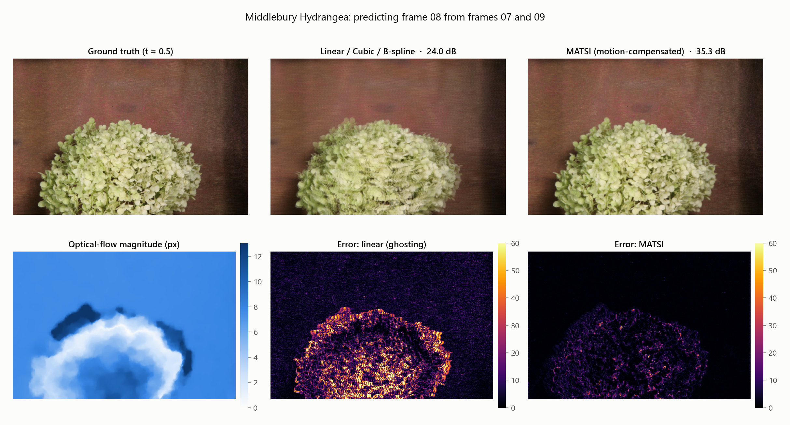
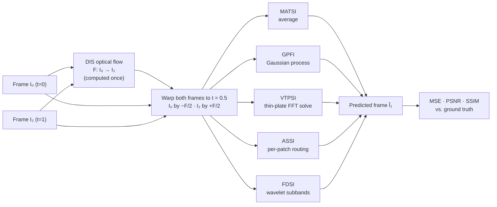
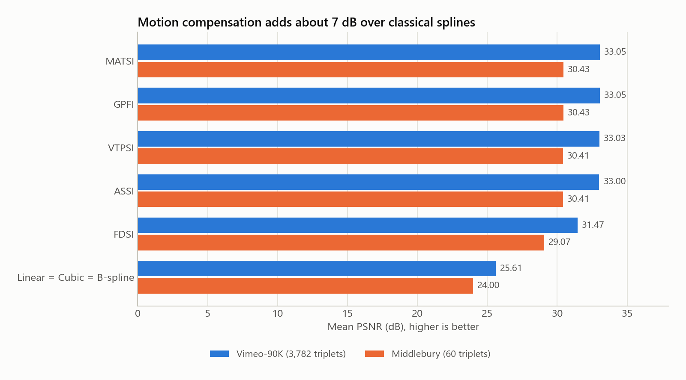
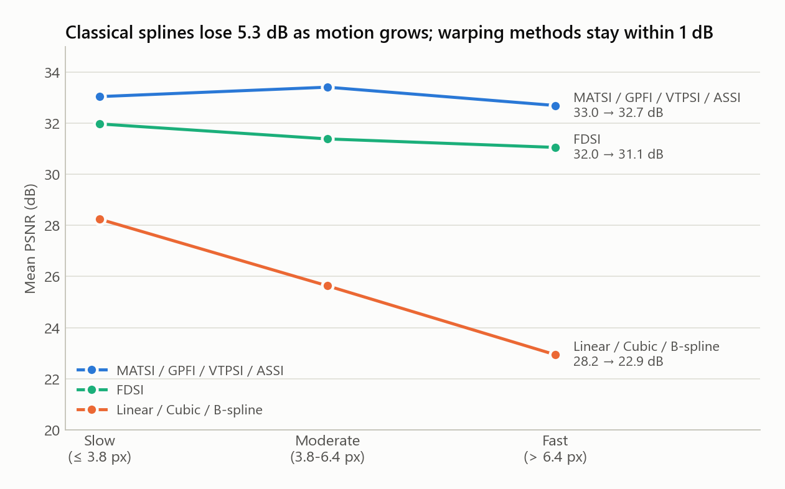
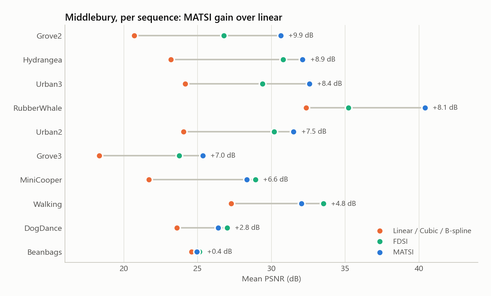
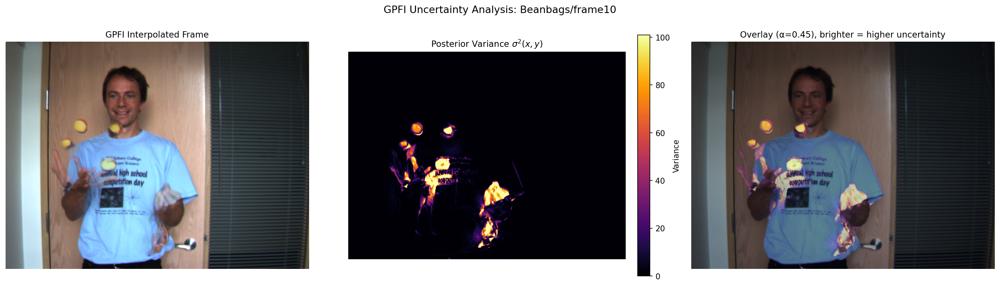

<div align="center">

# SplineWarp

Motion-compensated spline interpolation for video frames, with no learned parameters.


</div>

Given two video frames at t = 0 and t = 1, predict the missing frame at t = 0.5.

The project has 8 interpolation methods: 3 classical splines and 5 methods that first warp the frames along optical flow. Each is evaluated on Vimeo-90K (3,782 triplets) and Middlebury (60 triplets).



Averaging the two input frames pixel by pixel (middle) leaves a double image wherever something moves. MATSI (right) warps both frames along the optical flow before averaging, which gains 11.3 dB on this frame.

## Results at a glance

- With only two frames, cubic and B-splines give exactly the same result as linear interpolation. The outputs match on all 3,842 test triplets.
- Warping along optical flow raises PSNR on Vimeo-90K from 25.61 to 33.05 dB, and SSIM from 0.753 to 0.949.
- From slow to fast motion, the classical methods drop 5.3 dB. MATSI, GPFI, VTPSI and ASSI vary by 0.72 dB at most, and FDSI by 0.92 dB.
- Middlebury gives the same ranking, from 24.00 dB (linear) to 30.43 dB (MATSI).
- The best result is 2.56 dB below RIFE (ECCV 2022), a trained network.

## How it works



## Methods

| Method | Type | What it does |
|---|---|---|
| Linear | Classical | $\hat I_1 = (I_0 + I_2)/2$ |
| Cubic spline | Classical | Natural cubic spline per pixel. Through two points this is a straight line. |
| B-spline | Classical | Cubic B-spline per pixel, same result as the cubic spline. |
| MATSI | Motion-compensated | Warps $I_0$ by $-F/2$ and $I_2$ by $+F/2$, then averages them. |
| GPFI | Motion-compensated | Gaussian process with an RBF kernel on the warped values. Also returns an uncertainty map. |
| VTPSI | Motion-compensated | Minimises $\lambda_1\lVert W(I_0)-\hat I\rVert^2 + \lambda_2\lVert W(I_2)-\hat I\rVert^2 + \lambda_3\lVert\nabla^2\hat I\rVert^2$ in closed form with a 2-D FFT. |
| ASSI | Motion-compensated | Chooses Linear, MATSI or VTPSI for each 32×32 patch from local motion and texture. |
| FDSI | Motion-compensated | Splits each frame with a one-level `db2` wavelet transform and warps every subband. |

## Results

### Overall



<details>
<summary>Full numbers (mean ± std)</summary>

Vimeo-90K test set (3,782 triplets, 448×256):

| Method | MSE ↓ | PSNR (dB) ↑ | SSIM ↑ |
|---|---|---|---|
| Linear / Cubic / B-spline | 288.72 ± 301.25 | 25.61 ± 4.60 | 0.7526 ± 0.1707 |
| MATSI | 51.68 ± 53.11 | 33.05 ± 4.50 | 0.9489 ± 0.0302 |
| GPFI | 51.68 ± 53.11 | 33.05 ± 4.50 | 0.9489 ± 0.0302 |
| VTPSI | 51.88 ± 53.16 | 33.03 ± 4.49 | 0.9486 ± 0.0303 |
| ASSI | 51.99 ± 53.14 | 33.00 ± 4.47 | 0.9479 ± 0.0306 |
| FDSI | 70.99 ± 67.04 | 31.47 ± 4.33 | 0.9235 ± 0.0486 |

Middlebury Other (10 sequences, 60 triplets):

| Method | MSE ↓ | PSNR (dB) ↑ | SSIM ↑ |
|---|---|---|---|
| Linear / Cubic / B-spline | 344.84 ± 249.77 | 24.00 ± 3.67 | 0.6904 ± 0.1839 |
| MATSI | 88.92 ± 70.11 | 30.43 ± 4.54 | 0.9092 ± 0.0582 |
| GPFI | 88.92 ± 70.11 | 30.43 ± 4.54 | 0.9092 ± 0.0582 |
| VTPSI | 89.07 ± 70.02 | 30.41 ± 4.52 | 0.9088 ± 0.0578 |
| ASSI | 89.00 ± 69.96 | 30.41 ± 4.50 | 0.9088 ± 0.0576 |
| FDSI | 107.62 ± 78.38 | 29.07 ± 3.52 | 0.8680 ± 0.0749 |

</details>

### Motion speed (Vimeo-90K)

The triplets are split into three groups of about 1,250 each by mean optical-flow magnitude.



### Per sequence (Middlebury)



Warping helps most on Grove2, Hydrangea and Urban3, where large areas move together. FDSI is lower than MATSI on average, but it scores higher on 4 of the 10 sequences (Walking, MiniCooper, DogDance and Beanbags).

### GPFI uncertainty map

The map is the GP variance plus the squared difference between the two warped frames. It is brightest along the edges of moving objects, where the prediction is least reliable.



### Compared with trained networks (Vimeo-90K)

| Method | Trained | PSNR (dB) | SSIM |
|---|:---:|---:|---:|
| Linear | no | 25.61 | 0.753 |
| **SplineWarp (ours, MATSI)** | **no** | **33.05** | **0.949** |
| Super SloMo (CVPR 2018) | yes | 33.15 | 0.948 |
| RIFE (ECCV 2022) | yes | 35.61 | 0.978 |
| EMA-VFI (CVPR 2023) | yes | 36.64 | 0.980 |
| AMT (CVPR 2023) | yes | 36.67 | 0.981 |
| VFIMamba (NeurIPS 2024) | yes | 36.92 | 0.982 |

SplineWarp's best method (MATSI, tied with GPFI) is 2.56 dB below RIFE and 3.87 dB below VFIMamba, without any training. Scores for the trained networks are the ones reported in their papers.

## Running it

```bash
pip install -r requirements.txt
# optional GPU build of PyTorch (CUDA 12.8)
pip install torch torchvision --index-url https://download.pytorch.org/whl/cu128

# Middlebury (about 97 s on a GPU)
python eval_middlebury.py --vis

# Vimeo-90K
python main.py --max-triplets 50 --vis   # quick test
python main.py --vis                     # full run, about 21 min on an RTX 5070 Ti
```

### Datasets

The datasets are not included in the repo. Download them and place them in the project root as shown below. The scripts use these paths by default.

1. **Vimeo-90K** (1.7 GB): on [toflow.csail.mit.edu](http://toflow.csail.mit.edu), download the triplet test set ("Test set only"). Extract it into the project root so the folders match the layout below.
2. **Middlebury** (34 MB): download [other-color-allframes.zip](https://vision.middlebury.edu/flow/data/comp/zip/other-color-allframes.zip) from the [Middlebury flow page](https://vision.middlebury.edu/flow/data/). Create a folder `other-color-allframes/` and extract the zip inside it.

```
spline_interpolation_project/
├── vimeo_interp_test/
│   └── vimeo_interp_test/
│       ├── input/            # 00001/0389/im1.png, im3.png, ...
│       ├── target/           # 00001/0389/im2.png, ...
│       └── tri_testlist.txt
└── other-color-allframes/
    └── other-data/
        ├── Beanbags/         # frame07.png ... frame14.png
        ├── DogDance/
        └── ...
```

If you put the data somewhere else, pass `--dataset-root` to `main.py` or `--data-root` to `eval_middlebury.py`.

<details>
<summary>Command-line options</summary>

| Script | Flag | Meaning |
|---|---|---|
| `main.py` | `--max-triplets N` | Evaluate only the first N triplets |
| | `--vis` | Save comparison grids and GPFI maps for 10 triplets |
| | `--dataset-root PATH` | Vimeo root (default `vimeo_interp_test/vimeo_interp_test`) |
| | `--workers N` | CPU worker processes (forced to 1 when CUDA is used) |
| | `--output-dir`, `--figures-dir` | Where CSVs and figures go (default `outputs`, `figures`) |
| `eval_middlebury.py` | `--data-root PATH` | Default `other-color-allframes/other-data` |
| | `--vis`, `--vis-samples N` | Save visuals for the first N triplets (default 5) |
| | `--output-dir`, `--figures-dir` | Default `outputs_middlebury`, `figures_middlebury` |

</details>

## Files

```
├── interpolation.py        # the 8 methods, DIS flow, GPU warp
├── main.py                 # Vimeo-90K evaluation
├── eval_middlebury.py      # Middlebury evaluation
├── metrics.py              # MSE, PSNR, SSIM
├── visualisation.py        # plotting
├── data_utils.py           # Vimeo-90K loading
├── assets/                 # README figures and the script that draws them
├── outputs/                # Vimeo-90K per-triplet metrics and sample predicted frames
├── outputs_middlebury/     # Middlebury per-triplet metrics
├── figures/                # Vimeo-90K plots
├── figures_middlebury/     # Middlebury plots
└── RESULTS.md              # all result tables
```

## Limitations

- MATSI and GPFI produce the same frame. At the midpoint between two samples, a symmetric kernel gives each frame a weight of ½. What GPFI adds is the uncertainty map.
- On Middlebury, each triplet predicts frame N+1 from frames N and N+2. This is not the official Middlebury interpolation protocol, so the scores can't be compared with published Middlebury results.
- No two-frame method can recover pixels hidden in both input frames. The accuracy of the DIS optical flow limits every motion-compensated method.

## Data and tools

- Vimeo-90K: Xue et al., *Video Enhancement with Task-Oriented Flow*, IJCV 2019.
- Middlebury: Baker et al., *A Database and Evaluation Methodology for Optical Flow*, IJCV 2011.
- DIS optical flow: Kroeger et al., ECCV 2016, via OpenCV.

## License

MIT License, copyright (c) 2026 Aymane Khaldi. See [LICENSE](LICENSE).
